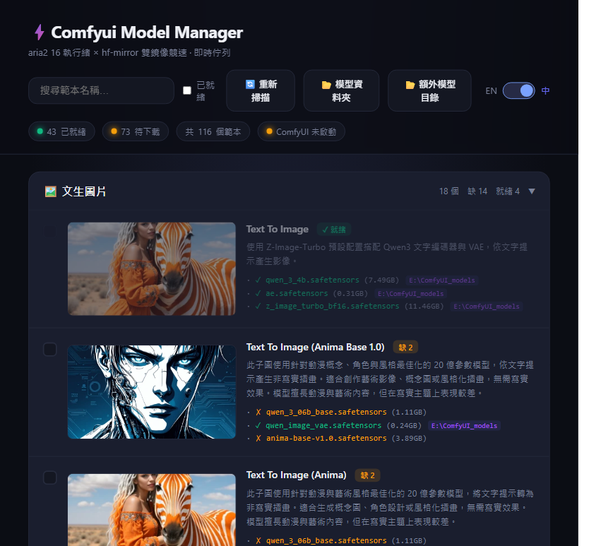
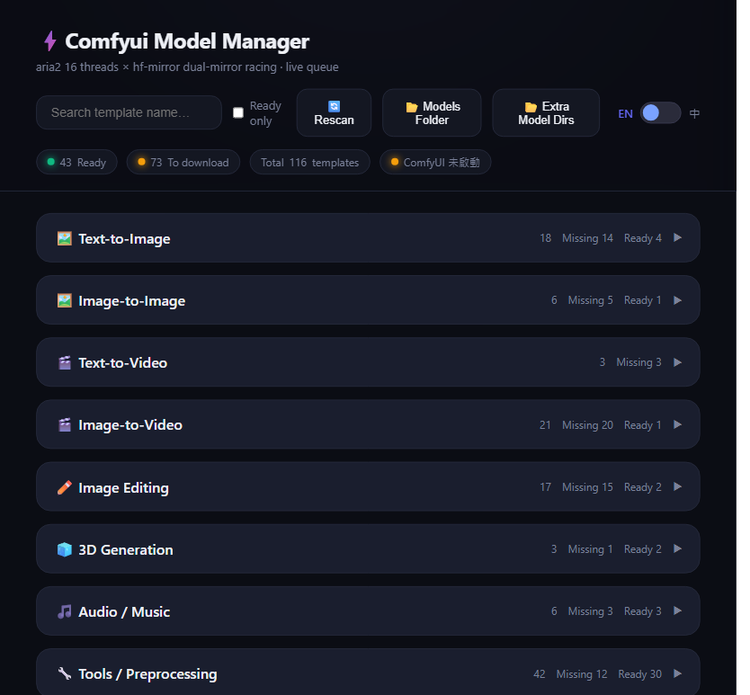
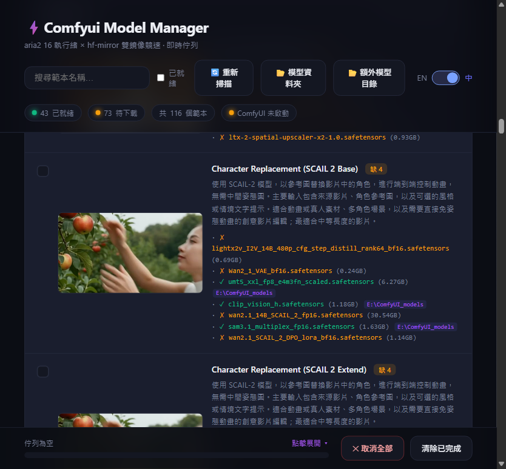

# ⚡ ComfyUI Model Manager（ComfyUI 模型管理器）


**再也不用手動找模型檔。** ComfyUI Model Manager 會掃描你機器上所有官方工作流範本，告訴你每個範本需要哪些模型檔案、哪些已齊全、哪些缺檔，並用 aria2 多執行緒以最高速度補齊——全程不需要啟動 ComfyUI。

> 🌏 [English README](README.md)




## ✨ 為什麼你需要它

部署 ComfyUI 要下載**數百 GB** 的模型，官方下載器卻慢得令人絕望。本工具把 30 分鐘的下載變成 2 分鐘——更重要的是，它先告訴你**到底該下載什麼**。

- 🔍 **智慧範本掃描** — 掃描所有官方工作流範本（內建 116+），解析每個 `CheckpointLoader` / `VAELoader` / `UNETLoader` 節點，比對你已有哪些模型、缺哪些。
- ⚡ **aria2 16 執行緒加速下載** — 多連線分段、**hf-mirror 雙鏡像競速**（哪個鏡像先回應就用哪個）、斷點續傳、批次佇列。
- 🧩 **兩用根目錄偵測** — 可攜版與非可攜版只差一個目錄層級，本工具自動偵測，零設定。
- 🚫 **不啟動 ComfyUI 就能用** — 完全獨立執行，不佔用你的 8188 埠、不動你的工作流。
- 🌐 **雙語介面** — 繁體中文／英文，動態左右滑塊一鍵切換，首次開啟自動偵測系統語言。
- 🤖 **自動翻譯** — 偵測到新範本時自動抓取官方英文說明並翻譯成中文，兩種語言都會保存。
- 🖼️ **官方縮圖與智慧分類** — 自動下載官方目錄縮圖；依官方說明把範本分類到 8 大類別。
- 📦 **額外模型目錄** — 讀取你的 `extra_model_paths.yaml`，一併比對設定目錄裡的模型。
- 💾 **容量比對** — 比對本機檔案與預期容量，標示不完整／損壞的檔案，並顯示每個模型的磁碟用量。
- ✅ **就緒狀態追蹤** — 標記為就緒的範本下次掃描直接跳過，只重新比對缺檔的。

### 和 ComfyUI-Manager 有什麼不同？

[ComfyUI-Manager](https://github.com/ltdrdata/ComfyUI-Manager) 是很優秀的自訂節點管理器，也提供**選配**的 aria2 下載——但它要求你自己架設 aria2 RPC 伺服器（官方教學用 Docker 容器），並設定環境變數。

| | ComfyUI-Manager | ComfyUI Model Manager |
|---|---|---|
| aria2 加速 | 選配——需自己架 aria2 伺服器 | **內建、零設定**（自動下載 aria2c） |
| 多連線分段 | 看你的伺服器設定 | **自動 16 執行緒** |
| 鏡像競速 | 無 | **hf-mirror 雙鏡像競速**（先回應者勝出） |
| 官方範本掃描 | 無 | 掃描 116+ 官方範本、標示缺檔 |
| 不啟動 ComfyUI | 不行（以外掛安裝） | **可以——完全獨立執行** |

兩者其實互補：**ComfyUI-Manager** 負責打理你的自訂節點，**Model Manager** 負責找出並極速補齊你的工作流真正需要的模型。

## 🖼️ 介面

英文介面（分類總覽與統計）：



展開範本細節 — 縮圖、官方介紹、每個所需模型檔案的 ✓／✗ 狀態、容量與位置：



## 📦 安裝

### 需求

- Windows / Linux / macOS（任何能跑 Python + aria2 的系統）
- Python 3.10+（可攜版 ComfyUI 內建 `python_embeded`，什麼都不用裝）
- **aria2c** — 若缺少，工具會自動下載

### 可攜版（推薦擺放方式）

```
D:\ComfyUI_Portable\            ← bundle 根目錄
├── ComfyUI\                    ← 應用本體（自動偵測）
└── Comfyui_Model_Manager\      ← 把這個資料夾放在這裡
    ├── standalone_server.py
    ├── ui.html
    └── Start_Model_Manager.bat
```

1. 下載 ZIP 或 `git clone` 本專案。
2. 把資料夾放在可攜版 bundle 內、**與 `ComfyUI` 資料夾同層**。
3. 雙擊 `Start_Model_Manager.bat`（或執行 `python standalone_server.py`）。
4. 瀏覽器開啟 **http://127.0.0.1:8190**。

完成——無需設定、無需啟動 ComfyUI。

### 非可攜版

把本資料夾放在 ComfyUI 根目錄**裡面**（深一層），讓它的父目錄就是根目錄：

```
~/ComfyUI/                      ← 根目錄（含 main.py + models/）
└── Comfyui_Model_Manager/      ← 把這個資料夾放在這裡
```

也可以用參數強制指定根目錄：

```bash
python standalone_server.py --root D:/path/to/ComfyUI
# 或
set COMFYUI_ROOT=D:/path/to/ComfyUI
python standalone_server.py
```

### 確認 aria2（可選）

工具第一次執行會自動把 aria2c 下載到自己的資料夾。想手動安裝，把 `aria2c.exe` 放到 PATH 即可。

## 🚀 使用方式

1. **首次掃描** — 按「重新掃描」。首次掃描要逐個解析範本 JSON，會比較久（顯示「首次掃描較耗時...」）。
2. **看缺口** — 範本分為 8 大類別。每張卡片有縮圖、官方介紹與每個所需模型檔案的狀態：
   - `✓` 已存在（含容量與位置）— `✗` 缺檔（含遠端容量）— `⚠` 不完整。
3. **勾選並下載** — 勾選缺檔的範本，按「加入下載清單」再開始下載。aria2 會把每個檔案切成 16 個連線，並在 `huggingface.co` 與 `hf-mirror.com` 之間競速選擇最快的鏡像。
4. **重新掃描** — 已就緒的範本會被記住並跳過，只重新比對新增／缺檔的。
5. **開啟資料夾** — 「模型資料夾」以全螢幕方式開啟你的 `models/`；「額外模型目錄」會把 `extra_model_paths.yaml` 設定的每個目錄都開出來。

## ⚙️ 技術架構

| 項目 | 說明 |
|---|---|
| 後端 | 純 Python 標準庫 `http.server` — **零 pip 依賴** |
| 前端 | 單一 `ui.html`，深色現代介面，無外部 CDN |
| 範本來源 | ComfyUI 內建官方 `comfyui_workflow_templates_json` |
| 下載引擎 | `aria2c`（自動下載）— 16 執行緒、雙鏡像競速、斷點續傳 |
| 縮圖 | 官方工作流輸出圖，快取於 `thumbs/`，7 天週期更新 |
| 翻譯 | 自動抓官方英文說明 + Google GTX 免費端點 → 繁體中文，存於 `descriptions.json` |
| 狀態 | `scan_state.json` — 記住就緒／確認／缺檔狀態，之後掃描快很多 |

## ❓ 常見問題

**Q: 顯示「找不到 ComfyUI 根目錄」。**
A: 工具只向上看一層。可攜版必須放在 `ComfyUI` 資料夾**旁邊**；一般安裝必須放在根目錄**裡面**。或用 `--root` 指定。

**Q: ComfyUI 正在跑，會互相干擾嗎？**
A: 不會。管理器獨立運行在 **8190** 埠，完全不碰 ComfyUI 自己的 8188。

**Q: 下載很慢。**
A: 鏡像競速預設開啟。若你的網路在中國以外，可在 `_mirror_urls()` 中移除 hf-mirror 回退，只連 `huggingface.co`。

**Q: 會重複下載已有的模型嗎？**
A: 不會。已就緒範本會被標記確認並在之後掃描中跳過；已有檔案會依容量驗證，不會盲目重抓。

**Q: 中文介紹從哪來？**
A: 官方範本沒有中文字段，管理器會自動翻譯並快取中英兩種說明（`descriptions.json`）。已涵蓋的範本即時顯示，全新範本會在背景幾秒內翻譯完成。

## 📄 授權

MIT — 個人與商業使用皆免費。
